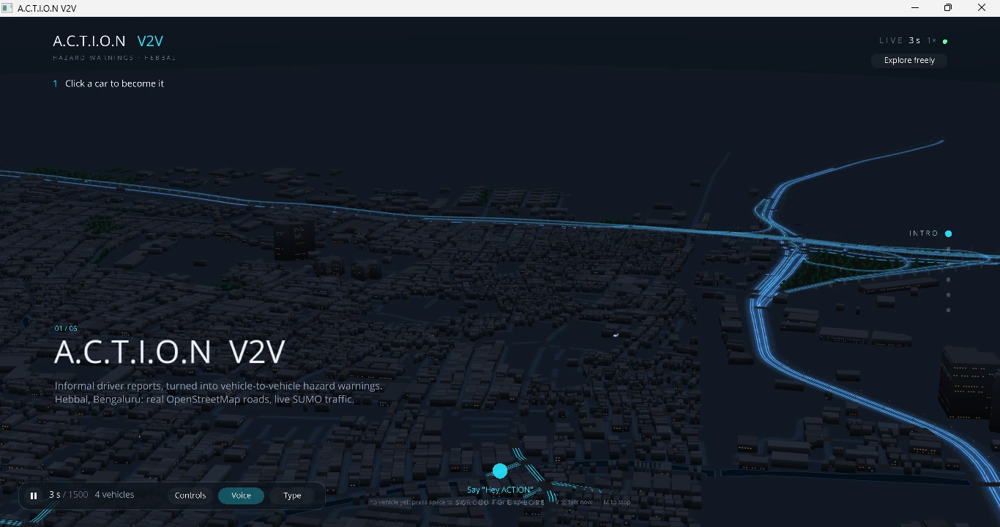
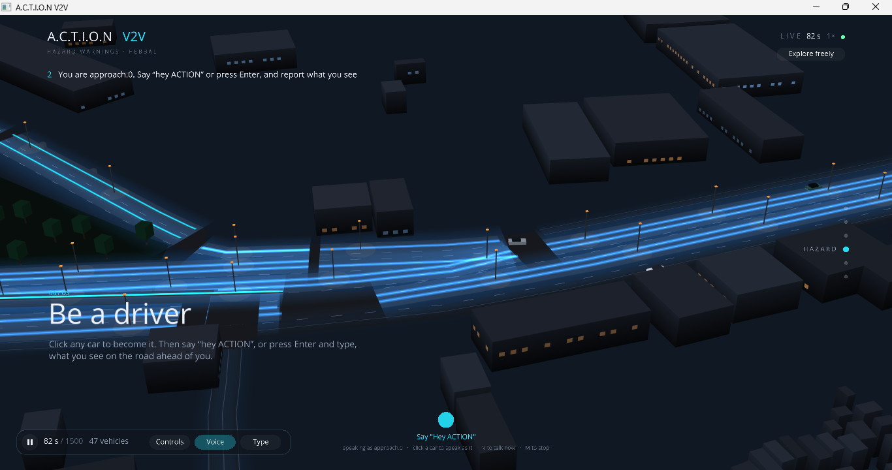
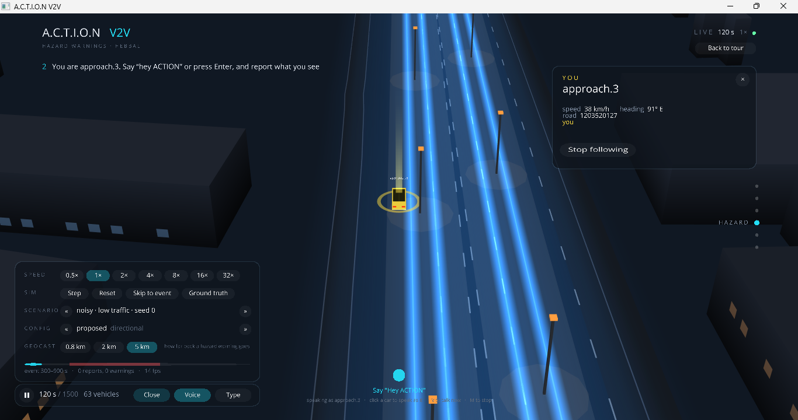
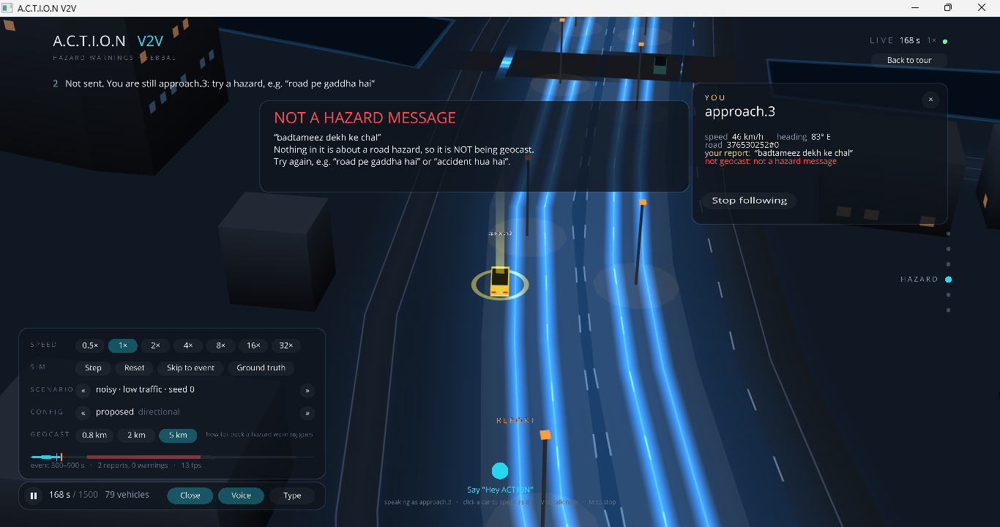
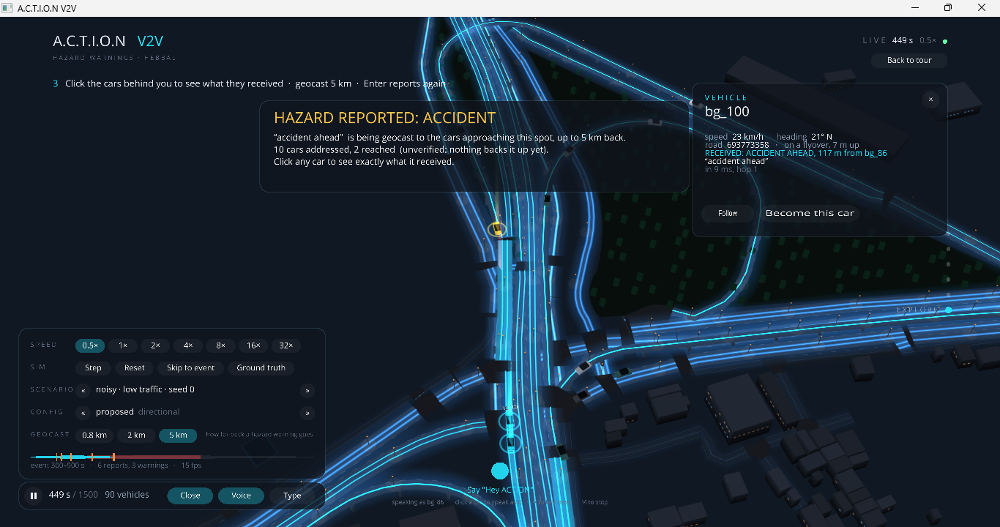
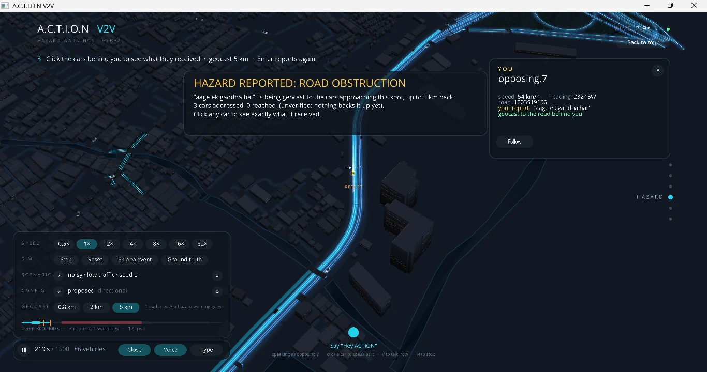

# A.C.T.I.O.N-V2V

From informal Indian driver reports to reliable V2V hazard warnings: a confidence-aware
NLP and direction-sensitive geocasting framework, evaluated in SUMO on a real
OpenStreetMap road network. Python only. Real data only.

## Quick start

```bash
pip install -e ".[dev]"          # add ,data / ,nlp / ,sim / ,dashboard for your module
pytest
python -m v2v.pipeline --config proposed
```

Real road network (needs the `sim` extras; output in git-ignored `sim_out/`):

```bash
pip install -e ".[dev,sim]"
python -m v2v.sim.osm_network --corridor hebbal     # OSM snapshot 2026-10-01, left-hand traffic
python -m v2v.sim.gazetteer --corridor hebbal      # real OSM landmarks -> network edges
python -m v2v.sim.scenarios --corridor hebbal --seeds 0 1   # 3 conditions x 3 densities, SUMO-validated
python -m v2v.sim.traci_loop sim_out/scenarios/hebbal/noisy-medium-s0   # play one, log reports
python -m v2v.sim.recorder sim_out/scenarios/hebbal/*-s0   # record runs for the dashboard
pip install -e ".[dashboard]" && streamlit run dashboard/app.py
V2V_NETWORK_TESTS=1 pytest tests/test_osm_network.py tests/test_gazetteer.py \
    tests/test_scenarios.py tests/test_traci_loop.py tests/test_live.py
```

Interactive 3D simulation (Panda3D/Ursina, free and open source; runs on integrated
graphics). Real Hebbal roads and flyovers, OSM buildings and lake, live SUMO traffic;
each report runs through the real pipeline and the view shows the geocast zone, every
V2V hop along the actual relay tree (in slow motion), and who was warned, missed or
warned needlessly against SUMO's ground truth:

```bash
pip install -e ".[sim,sim3d]"
python -m v2v.sim.world3d --corridor hebbal       # once: buildings, water, parks
python dashboard/sim3d/app.py                    # --scenario noisy-low-s0 --config baseline_a
# Driver sandbox (default): click a car to become it, say "hey ACTION" or press Enter and type a
# report. Hazards are geocast (up to --radius km, default 5) to the cars that need them; anything
# else is refused. Click other cars to see what they received. --scripted plays the dataset demo.
```

### Driver sandbox: be a car, report a hazard

The 3D app opens as a sandbox on real SUMO traffic. You are a driver, not a viewer:

1. **Click any car** to become it. It turns gold, the camera follows it, and the line at the
   top says what to do next.
2. **Speak or type.** Say "hey ACTION" and then the report, or press Enter and type it.
3. **A hazard is geocast, and only a hazard.** The banner says what it was taken as and how
   many cars were addressed and reached. Anything else is refused, not sent.
4. **Click the other cars** to see exactly what each one received, or why it got nothing.





You are a car (gold, with the YOU card). The Controls panel has the geocast radius, 0.8, 2
or 5 km (`--radius`, default 5), which is how far back along the road a warning travels:



A message that is not about a road hazard is **not geocast**:



A hazard is geocast to the cars that need it. Clicking one of those cars shows the warning it
received, how far it was from the reporter, and the radio hop it came through:



Reach depends on traffic. The radio range is 300 m and relays cannot cross an empty road, so
on sparse traffic a warning may be addressed to cars it never reaches (below: 3 cars
addressed, 0 reached). Dense traffic reaches nearly every addressed car:



Typing (Enter) always works. If the microphone is silent, run
`python -m v2v.voice.listener --devices`, then `--check --mic <number>` with a number that shows
bars while you speak, and set `V2V_MIC` to it. Report text spoken or typed in the demo is
labelled as fixture text and is never data or a result. `--scripted` plays the dataset's
scripted reports and hazard instead of the sandbox.

It opens as a scroll-driven tour: the mouse wheel (or the arrow keys) glides the camera
through six chapters (the corridor, the flyovers, the hazard, the geocast region) and the
camera flies to the geocast view when a warning goes out. Drag to explore freely; T or
"Back to tour" returns. Click a vehicle or the hazard for its card; the controls fold
into the dock at the bottom left (C). Space play/pause, K skip to the event, N step,
R reset, F follow, G ground truth, 1-7 speed, [ ] scenario, Tab hide the interface,
F11 full screen, `--no-bloom` on slower GPUs. **Voice in the 3D view:** press M (or the Voice button on the dock)
to turn the microphone on, say "hey ACTION" and then the report; V talks without the wake
phrase. The words appear live at the bottom, the report runs through the real pipeline as the
car you clicked (click a car to speak as it), and the
verdict, geocast zone and relay hops appear on the road. Needs `pip install -e ".[voice]"` and
`python -m v2v.voice.listener --download` once. Report text stays fixture text (labelled
in the card) until P1's real test split exists.

The web dashboard has two modes, switched with the two buttons at the top of its rail.
**Overseer** is the fleet-wide view of recorded runs (live map, network, reports, policy
comparison). **Driver** puts you in one of two demo vehicles, a car (Tata Nexon EV) on the
approach to the hazard and a scooter (Ather 450X) on the opposite carriageway, added to a
live SUMO run as real vehicles: a heading-up perspective navigation view of the real roads
and buildings, the route ahead and the path travelled, speed and turn cues, traffic in
sight, only the V2V messages that vehicle received (with where they are relative to it),
and three driver alerts of its own, one per geocast direction.

**Voice report** (third button on the dashboard rail): pick a vehicle, start the microphone
and say "hey ACTION, mujhe ek bandar road pe naacha hua dikh raha hai". Speech is recognised
offline with Vosk (a wake-phrase model, then a Hindi model for the report), nothing leaves the
laptop and no audio is stored. The words appear live, then the report runs through the real
pipeline from that vehicle: Devanagari is respelled as Hinglish, personal details are scrubbed,
the NLP reads it, the confidence stage decides whether it is safe to send (confirmed,
unverified or blocked), and a template warning goes by directional geocast to the drivers
behind the vehicle. A text box and tap-to-talk work without the wake phrase.

```bash
pip install -e ".[voice]"
python -m v2v.voice.listener --download      # once: two speech models, about 80 MB
python -m v2v.voice.listener                 # try the microphone in the terminal
```

Spoken reports are live demo input (`source="fixture"`): never data, never results.

Directional geocast (`geocast/directional.py`) covers stretches of directed road (SUMO
edges are one carriageway each) within the radius by driving distance: **backward**
(traffic approaching the point on its carriageway: accident, obstruction, stopped or
braking vehicle), **forward** (traffic ahead) or **bidirectional** (approaching on both
carriageways: a slippery road, which the simulation then slows on both sides too).
Relaying uses counter-based suppression (Ni et al. 1999), and a vehicle never receives the
same warning twice.

Configs: `baseline_a`, `baseline_b`, `proposed`, `ablation_direction`,
`ablation_confidence`. Right now the pipeline runs on stubs and a toy two-way road
(`src/v2v/sim/toy_world.py`); each stub is replaced by its owner's PR.

## Pipeline

| Stage | Module | Owner |
|---|---|---|
| 1 Report input | `nlp/preprocess.py` | P1 |
| 2 NLP interpretation | `nlp/classifier.py`, `extract.py`, `calibrate.py` | P2 |
| 3 Confidence & context | `confidence/` | P3 |
| 4 Direction-sensitive geocast | `geocast/` | P4 |
| 5 Structured warning | `messages/warning.py` | P2 |
| Simulation & delivery | `sim/` | P4 |
| Orchestration & evaluation | `pipeline.py`, `eval/`, `experiments.py` | P3 |
| Data | `data/` | P1 |

Modules only exchange the types in `src/v2v/contracts.py`.

## Working rules

- Branch `p<n>/<pr-id>-<slug>`, small PRs, one review from your pair (P1↔P2, P3↔P4).
  Changes to `contracts.py` need all four approvals. Never merge your own PR.
- CI must be green: ruff, mypy, pytest, Python share ≥ 95%, real data sources only,
  frozen test split untouched, pipeline smoke run.
- Data: real sources only (`survey`, `reddit`, `youtube`, `news_dataset`, `x`, `fir`).
  No generated text, ever. `data/raw/` is git-ignored; never commit credentials.
- Full plan: [`docs/build-plan.pdf`](docs/build-plan.pdf). Rules for Claude: [`CLAUDE.md`](CLAUDE.md).

Map data © OpenStreetMap contributors (ODbL).
